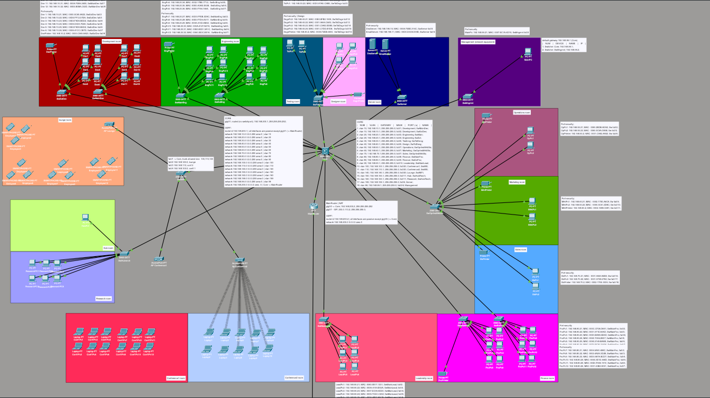
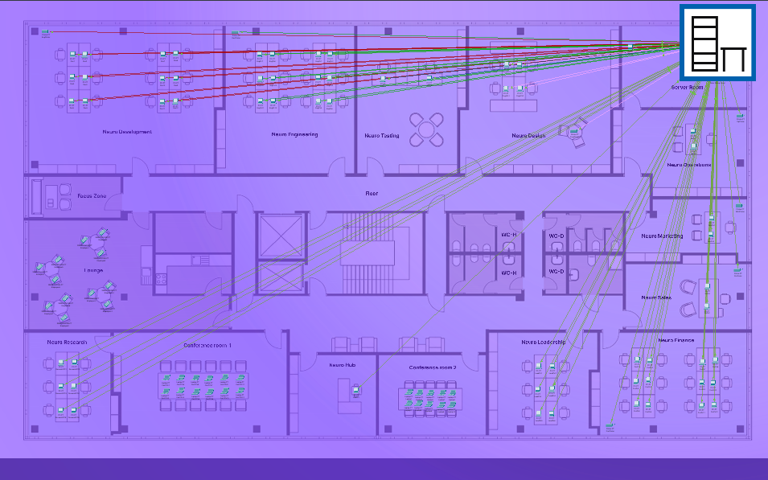
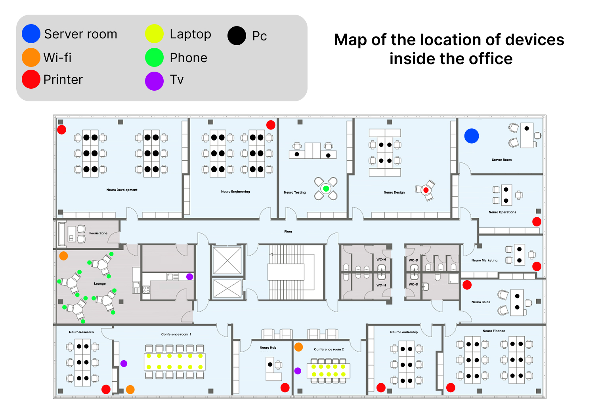
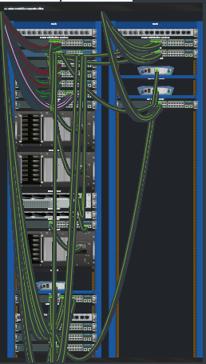

# Easy-lan


---

Учебный проект представляет собой комплексную модель корпоративной сетевой инфраструктуры, разработанную в Cisco Packet Tracer. Основная цель проект:
отработка архитектурных решений, протоколов маршрутизации и коммутации, а также механизмов защиты.

Проект включает в себя сегментацию отделов (VLAN), динамическую маршрутизацию, базовую защиту на уровне доступа (L2 Security), симуляцию выхода в глобальную сеть (ISP) и развертывание базовых сервисов (FTP / DNS / DHCP / IP-телефония).

---

## 🏗️ Реализованный функционал и технологии

### 🏢 Физический уровень и планировка (Physical Workspace)
* **Реалистичное проектирование офиса:** Сеть спроектирована поверх реального плана здания (Physical View) с учетом архитектурных зон, комнат и расстояний.
* **Кабельная инфраструктура:** Каждая рабочая станция, точка доступа и принтер физически размещены в соответствующих кабинетах (Neuro Development, Neuro Engineering, Neuro Leadership, Conference Rooms и др.) с трассировкой кабельных линий до кроссовых и серверных стоек.

### 🌐 Сетевая архитектура и L2 коммутация
* **Иерархическая топология:** Выделенное ядро сети на L3-коммутаторе (`3560-24PS Core`) и распределенные коммутаторы доступа (`2960-24TT`).
* **Отказоустойчивость L2 (Switch Redundancy):** Использование дублирующих коммутаторов на отдел (`SwMainDev` / `SwExtDev`, `SwMainEng` / `SwExtEng` и др.) для распределения нагрузки и резервирования точек подключения.
* **Изолированная сегментация (VLAN):** Разделение корпоративной сети на 18+ независимых VLAN под каждый отдел и задачу (Development, Engineering, Testing, Design, Operations, Marketing, Sales, Leadership, Finance, Research, Conference, Lounge, Server, Management).
* **Trunking & 802.1Q:** Транковые магистрали между Core и коммутаторами доступа с явным ограничением разрешенных VLAN (`switchport trunk allowed vlan`).

### 🔀 L3 Маршрутизация и WAN
* **Inter-VLAN Routing на Ядре:** Маршрутизация между всеми отделами реализована прямо на L3-коммутаторе `Core` через Switched Virtual Interfaces (SVI) с соответствующими IP-шлюзами.
* **Динамическая маршрутизация (OSPF Area 0):** Настроена публикация всех внутренних сетей через OSPF (`router-id 192.168.200.1` на Core и `192.168.200.2` на MainRouter).
* **Безопасность OSPF (Passive Interfaces):** Все пользовательские интерфейсы переведены в `passive-interface`, чтобы OSPF-трафик и приветственные пакеты (Hello packets) не отправлялись в клиентские сегменты.
* **Граница сети (Edge Router & NAT/PAT):** Пограничный маршрутизатор `MainRouter` выполняет трансляцию адресов (NAT/PAT) для безопасного выхода локальных устройств во внешнюю сеть под одним или пулом публичных IP.
* **Полноценная симуляция Интернета (ISP & External Web):** Выделенный маршрутизатор провайдера (`ISP-Router`, подсеть `203.0.113.0/24`) и изолированная зона с внешним публичным веб-сервером (`Server1`), имитирующая работу с глобальной сетью WAN.

### 🔒 Безопасность (L2 Protection & Isolation)
* **Строгий Port Security:** На портах коммутаторов доступа жестко прописана привязка разрешенных MAC-адресов устройств к конкретным портам (`fa0/X`), предотвращая несанкционированное подключение стороннего оборудования и MAC-flooding.
* **Изолированный VLAN управления (Out-of-Band Management):** Выделен специальный `VLAN 99 (Management)` и отдельный свитч `SwMngmnt` с рабочим местом администратора (`MainPC` `192.168.99.21`) для защищенного доступа к консолям оборудования.

### 🛠️ Инфраструктурные и корпоративные сервисы
* **DNS Server (`192.168.199.10`):** Локальный сервер доменных имен для резолва внутренних сервисов и внешних ресурсов.
* **Email Server (`192.168.199.11`):** Корпоративный почтовый сервер для обменa сообщениями внутри компании между сотрудниками разных отделов (SMTP/POP3).
* **Динамическая адресация (DHCP & Excluded IPs):** Автоматическая выдача IP-адресов клиентам с принудительным резервированием первых 10 адресов каждого диапазона (`.1` – `.10`) под статические шлюзы, серверы и периферию.
* **Корпоративный Wi-Fi:** Точки доступа `AccessPoint-PT` для беспроводных зон (Конференц-залы `Conference1`, `Conference2` и зона отдыха `Lounge room`).
* **Сетевая периферия:** Интеграция и фиксированная адресация сетевых принтеров в каждом отделе (`DevPrinter`, `EngPrinter`, `MrktPrinter` и др.).


## 📸 Визуальное представление проекта

| Логическая схема сети | Физический план здания |
| :---: | :---: |
|  |  |

| План расположения оборудования | Серверные стойки |
| :---: | :---: |
|  |  |

> Логическая схема показывает структуру сети и связи между устройствами. Физический план отражает реальное расположение оборудования по кабинетам и этажам здания.
>
> 

## 📚 Учебное руководство (Tutorial Index)

Пошаговые модули для развертывания сети с нуля в Cisco Packet Tracer:

1. [**Модуль 1: Physical Workspace & L2 Switch Setup**](./tutorial/01-physical-and-vlans.md)
   * Размещение оборудования по кабинетам на плане здания (Physical View).
   * Иерархия коммутаторов доступа: основной и расширительный в комнатах (`SwMainDev` + `SwExtDev`)
   * Создание VLANs, настройка Access-портов и Trunk-магистралей (`802.1Q dot1q`)[cite: 1].

2. [**Модуль 2: Core Switch Inter-VLAN Routing & DHCP**](./tutorial/02-intervlan-and-dhcp.md)
   * Настройка L3-коммутатора `Core 3560-24PS` и виртуальных интерфейсов SVI[cite: 1].
   * Маршрутизация между отделами компании[cite: 1].
   * Настройка встроенного DHCP-сервера на Ядре (`ip dhcp pool`) с исключениями IP-адресов (`ip dhcp excluded-address`)

3. [**Модуль 3: L2 Security & Port Security**](./tutorial/03-port-security.md)
   * Защита портов коммутаторов доступа (Port Security).
   * Жесткая привязка MAC-адресов устройств (`sticky` / `static mac`), защита от несанкционированных подключений и MAC-flooding.

4. [**Модуль 4: Dynamic Routing (OSPF Area 0)**](./tutorial/04-ospf-routing.md)
   * Настройка динамической маршрутизации OSPF между Ядром (`Core`) и пограничным роутером (`MainRouter`).
   * Задание `router-id` и изоляция клиентских портов через `passive-interface`.

5. [**Модуль 5: Edge Router, NAT/PAT & ISP Simulation**](./tutorial/05-nat-and-isp.md)
   * Выход сети в Интернет: настройка трансляции адресов (NAT/PAT) на `MainRouter`.
   * Симуляция глобальной сети через роутер провайдера (`ISP-Router`) и внешний веб-сервер.

6. [**Модуль 6: Network Services (DNS, Email & Wi-Fi)**](./tutorial/06-services-and-wifi.md)
   * Настройка серверной зоны (`VLAN 199`): локальный DNS-сервер и почтовый сервер (SMTP/POP3) для корпоративной почты.
   * Беспроводные зоны (Wi-Fi Access Points) в конференц-залах и Lounge-зоне.


## 📂 Структура репозитория
```text
easy-lan/
├── assets/                     # Изображения, схемы топологии и планировка офиса
│   ├── topology-logical.png    # Полная логическая схема сети
│   ├── topology-physical.png   # Физический план здания и кабинетов
│   ├── office-plan.jpg         # Фото плана офиса
│   ├── MapLocationDevices.jpg  # План расположения оборудования
│   └── rack-view.png           # Стойки и серверное оборудование
│
├── configs/                    # Текстовые конфигурационные файлы устройств (Startup/Running)
│   ├── core-sw-3560.txt        # Конфигурация L3-коммутатора Ядра (Core)
│   ├── edge-router-2911.txt    # Пограничный маршрутизатор (MainRouter / NAT)
│   ├── isp-router.txt          # Маршрутизатор провайдера (ISP)
│   └── switches/               # Конфигурации коммутаторов доступа по отделам
│       ├── sw-dev-main.txt
│       ├── sw-eng-main.txt
│       └── sw-mngmnt.txt
│
├── tutorial/                   # Пошаговые обучающие модули для развертывания сети
│   ├── 01-physical-and-vlans.md # Урок 1: Планировка, создание VLAN, Access & Trunk
│   ├── 02-port-security.md     # Урок 2: Защита портов уровня L2 и Sticky MAC
│   ├── 03-intervlan-and-core.md # Урок 3: SVI, Inter-VLAN маршрутизация на L3 Sw
│   ├── 04-ospf-routing.md      # Урок 4: Динамическая маршрутизация OSPF Area 0
│   ├── 05-nat-and-isp.md       # Урок 5: Трансляция NAT/PAT и симуляция WAN/ISP
│   └── 06-services-and-wifi.md # Урок 6: DHCP pools, DNS, Email и точки Wi-Fi
│
├── easy-lan-topology.pkt       # Исходный проект Cisco Packet Tracer (.pkt)
├── LICENSE                     # Лицензия проекта (MIT)
└── README.md                   # Главный презентационный файл репозитория
