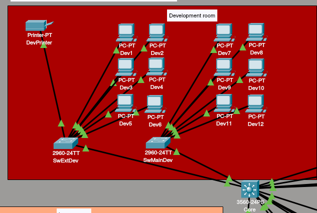
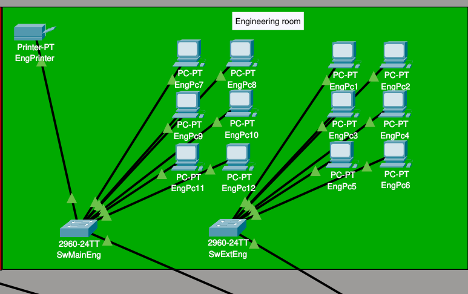
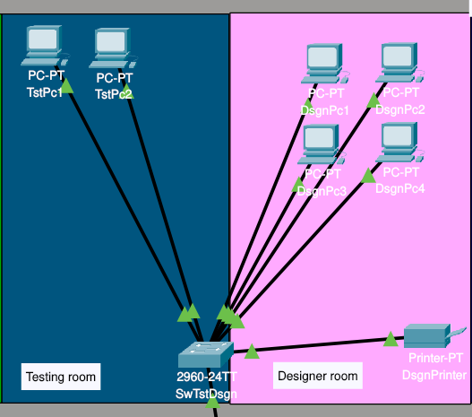
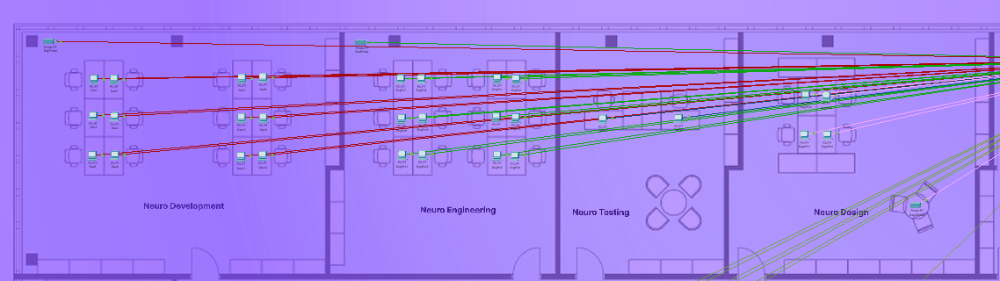

# Модуль 1: Physical Workspace, VLANs & Trunking

## 📌 Цель модуля

Понять, как спроектировать физическую сеть офиса, логически разделить отделы с помощью **VLAN** и соединить коммутаторы между собой через **Trunk (802.1Q)**, чтобы сеть была гибкой и легко расширяемой.

---

## 📚 Теория

Прежде чем вводить команды в CLI, разберем **ЧТО** мы делаем и **ЗАЧЕМ**.

### 🌐 Что такое VLAN и зачем он нужен?
**VLAN** (*Virtual Local Area Network*) - это способ разделить один физический коммутатор на несколько логических изолированных сетей.

> **Аналогия:** 
> Представим открытый офис. Если все 200 сотрудников сидят в одной комнате, там будет очень шумно, каждый отдел кричит про свои задачи или проблемы. В сети этот шум называется **широковещательным трафиком (Broadcast)**.
> 
> **VLAN** — это возведение стен. Мы сажаем программистов в кабинет 10 (`VLAN 10`), а бухгалтерию в кабинет 20 (`VLAN 20`). Теперь:
> * Шум из одного кабинета не мешает другому.
> * У каждого кабинета **своя дверь**. Чтобы попасть в соседний кабинет, нужно выйти в общий коридор (L3-маршрутизатор) и **иметь разрешение**.
> * Разрешение выдаёт **администратор**, он решает, кому можно ходить в соседние отделы, а кому нет. Это называется **ACL (Access Control Lists)** списки контроля доступа.
>
> **Важно:** По умолчанию, после настройки VLAN, отделы **не видят** друг друга. Чтобы они начали общаться, администратор должен **сознательно** включить маршрутизацию между ними.

**Зачем нужен VLAN:**
* **Безопасность:** Отдел продаж не видит трафик финансового отдела на L2-уровне.
* **Оптимизация:** Broadcast-запросы не загружают всю сеть.
* **Гибкость:** Переезд сотрудника в другой кабинет не требует перекладки кабелей, достаточно изменить номер VLAN на порту.

---

### 🔌 Access Port vs 🚛 Trunk Port

Чтобы трафик правильно ходил по сети, порты коммутатора переводят в один из двух режимов:

| Режим порта | Для чего используется | Как работает |
| :--- | :--- | :--- |
| **Access Port** (Порт доступа) | Для конечных устройств (компьютеры, принтеры, IP-телефоны) | Работает только с **одним VLAN**. Порт **удаляет** VLAN-метку из кадра при передаче устройству и **добавляет** её при получении кадра от устройства. |
| **Trunk Port** (Магистральный порт) | Для связи «коммутатор-коммутатор», «коммутатор-роутер» или «коммутатор-сервер» (если на сервере несколько виртуальных машин в разных VLAN). | Пропускает трафик **нескольких VLAN одновременно**. Каждому кадру добавляется метка с номером VLAN по стандарту **802.1Q (dot1q)**. |

---

### Для чего нужен Trunk в реальной сети?

Trunk это **магистраль**, по которой бежит трафик из всех VLAN одновременно.

**В этом проекте:**

* На **Core** настроены DHCP-пулы для каждого VLAN:
  * `VLAN 10` → `192.168.10.0/24`
  * `VLAN 20` → `192.168.20.0/24`
  * `VLAN 30` → `192.168.30.0/24`

* Порт Core, который идёт в SwMainDev, настроен как **Trunk**.
* Почему? Потому что по одному кабелю должны ходить:
  * DHCP запросы из VLAN 10 (от разработчиков)
  * DHCP запросы из VLAN 20 (от инженеров)
  * Обычный трафик из этих же VLAN

**Если бы порт был Access, он пропускал бы только один VLAN.** Все остальные отделы остались бы без ip адресов и без связи с Core.

**Trunk = один кабель, много VLAN.**

--

### 📦 Расширение портов в отделе (Switch Cascading)

Что делать, если в отделе разработки 35 человек, а коммутатор всего один на 24 порта?

**Решение:** Агрегирование каналов (EtherChannel / LACP).

> **EtherChannel** — технология, которая объединяет несколько физических портов в один логический канал. Вместо одного кабеля между коммутаторами — два или четыре. Это даёт:
> * **Увеличение пропускной способности** — два кабеля по 1 Гбит/с = 2 Гбит/с.
> * **Отказоустойчивость** — если один кабель перегорит, трафик пойдёт по второму.
> * **Балансировка нагрузки** — трафик распределяется между кабелями.

**Почему в этом проекте не EtherChannel?**

В Cisco Packet Tracer поддержка EtherChannel на моделях 2960 ограничена или работает нестабильно. Поэтому в проекте используется упрощённая, но рабочая схема:

```text
           [ Core 3560 ]
      │ (Trunk)        │ (Trunk)
[ SwMainDev ]     [ SwExtDev ]
 (24 порта)         (24 порта)
      │                  │
   ПК 1-24            ПК 25-35
```

--

## Практическая часть

### Масштабируемость и размещение оборудования:

Проект рассчитан на крупный офис с большим количеством рабочих мест, разделенных по кабинетам. Чтобы не перегружать центральную точку тысячами проводов от каждого пк, используется иерархическая структура:

1. В каждом кабинете устанавливаются коммутаторы доступа (Access Switches), к которым подключаются компьютеры сотрудников.

2. Магистральные каналы (Trunk) от всех кабинетов сходятся в Серверную комнату (Server Room).

3. В серверной комнате размещается коммутатор Ядра (Core Switch 3560), Серверы (DNS, Mail) и Пограничный роутер (MainRouter). Ядро выступает в роли высокоскоростного центра коммутации и маршрутизации между всеми сегментами здания.

Но для наглядности, на схеме я расположу его в центре. 

### Написание конфигурации

1. Согласно схеме, перенесите компьютеры, коммутаторы на поле, и подключите их к Core:

<p align="center">
  
</p>

2. Настроим сначала Core. Внутри:

```cisco
Core> enable (войти в привилегированный режим, сокращенно en) 
Core# configure terminal

! 1. Создаем VLAN 10 и задаем ему имя
Core(config)# vlan 10
Core(config-vlan)# name Development
Core(config-vlan)# exit

! 2. Настраиваем виртуальный L3-интерфейс (SVI), это шлюз для VLAN 10
Core(config)# interface vlan 10
Core(config-if)# ip address 192.168.10.1 255.255.255.0
Core(config-if)# no shutdown
Core(config-if)# exit

! 3. Настраиваем магистральный порт (Trunk) в сторону SwMainDev
Core(config)# interface fa0/1
Core(config-if)# switchport trunk encapsulation dot1q
Core(config-if)# switchport mode trunk
Core(config-if)# switchport trunk allowed vlan 10
Core(config-if)# exit

! 4. Сохраняем конфигурацию в NVRAM, полная команда copy running-config startup-config, но обычно используют vm
Core# wr
```

3. Настройка коммутатора SwMainDev. Внутри:

```cisco
SwMainDev> en
SwMainDev# conf t (сокращено от configure terminal)

! 1. Создаем VLAN 10
SwMainDev(config)# vlan 10
SwMainDev(config-vlan)# name Development
SwMainDev(config-vlan)# exit

! 2. Настраиваем Trunk-порт в сторону Core
SwMainDev(config)# interface fa0/2
! Примечание: на L2-коммутаторах 2960 инкапсуляция dot1q стоит по умолчанию.
! Если команда ниже выдает ошибку, просто пропускаем её:
! SwMainDev(config-if)# switchport trunk encapsulation dot1q
SwMainDev(config-if)# switchport mode trunk
SwMainDev(config-if)# switchport trunk allowed vlan 10
SwMainDev(config-if)# exit

! 3. Настраиваем Access-порты для подключения ПК пользователей (например, Fa0/3 - 24)
SwMainDev(config)# interface range fa0/3 - 24
SwMainDev(config-if)# switchport mode access
SwMainDev(config-if)# switchport access vlan 10
SwMainDev(config-if)# exit

! 4. Сохраняем конфигурацию
SwMainDev# wr
```

4. Настройка коммутатора SwExtDev. Внутри:

```cisco
SwExtDev> en
SwExtDev# conf t

! 1. Создаем VLAN 10
SwExtDev(config)# vlan 10
SwExtDev(config-vlan)# name Development
SwExtDev(config-vlan)# exit

! 2. Настраиваем Trunk-порт к основному коммутатору SwMainDev
SwExtDev(config)# interface fa0/1
SwExtDev(config-if)# switchport mode trunk
SwExtDev(config-if)# switchport trunk allowed vlan 10
SwExtDev(config-if)# exit

! 3. Переводим порты для компьютеров в режим Access и привязываем к VLAN 10
SwExtDev(config)# interface range fa0/2 - 24
SwExtDev(config-if)# switchport mode access
SwExtDev(config-if)# switchport access vlan 10
SwExtDev(config-if)# exit

! 4. Сохраняем конфигурацию
SwExtDev# wr
```

### 5. Проверка конфигурации

Убедимся, что первый отдел настроен верно и сеть готова к работе:

**1. Проверка VLAN и Access-портов на `SwMainDev`:**

```cisco
SwMainDev# show vlan brief
```

Убедитесь, что:
* VLAN 10 имеет статус **active**.
* Порты `Fa0/3 - Fa0/24` назначены VLAN 10.

---

**2. Проверка состояния L3-интерфейса на Core:**

```cisco
Core# show ip interface brief
```

Интерфейс `Vlan10` должен иметь:
* IP-адрес `192.168.10.1`
* Статус **up/up**

---

**3. Тест связи (Ping):**

Назначьте любому ПК в отделе Development статический IP-адрес:
* **IP-адрес:** `192.168.10.10`
* **Маска:** `255.255.255.0`
* **Шлюз:** `192.168.10.1`

В командной строке ПК выполните:

```cmd
ping 192.168.10.1
```

**Ожидаемый результат:** Успешный отклик (`Reply from 192.168.10.1 ...`).

Это означает, что:
* L2-коммутация (VLAN, Access-порты) работает корректно.
* L3-шлюз (SVI на Core) доступен и готов маршрутизировать трафик.


Готово. Теперь у нас есть настроенная 1 комната. 

#### По такой же логике делаем другие комнаты:

1. Engineering room:

<p align="center">
  
</p>

2. Есть случаи, когда комнаты маленькие. Тогда для них можно использовать один коммутатор. Здесь уже будут настраиваться два VLAN на одном коммутаторе, и порты раскидываются либо по полам, либо большая часть портов отдается комнате, которой нужнее. Пример Testing room & Designer room:

<p align="center">
  
</p>

### Физический слой (Physical Layer)

В Cisco Packet Tracer физический слой — это не просто провода, а **реальное расположение устройств** в здании.

**В этом проекте:**
* Каждый отдел находится в своём кабинете.
* В серверной комнате стоят: Core Switch, DNS-сервер, Mail-сервер, MainRouter.
* Кабели проложены от серверной до каждого кабинета (Trunk-магистрали).

**Как это выглядит в Packet Tracer:**

1. Переключись в **Physical View** (иконка глобуса в правом нижнем углу).
2. Выбери здание, комнату, размести устройства.
3. Переключись обратно в **Logical View** для настройки.

> **Зачем это нужно?** В реальных офисах кабели имеют длину, а расстояние влияет на задержки. В PT это симулируется, но в учебных целях физический слой помогает понять **архитектуру** здания.

> [!NOTE]
> На данном этапе линии связи отображаются по кратчайшему пути между устройствами. Аккуратная прокладка кабелей через кабельные каналы (Cable Trays) и настройка ограничений по длине меди/оптики будут рассмотрены в отдельном блоке.
>
> Для базовой настройки логики VLAN работаем в **Logical View**.

#### Примеры комнат:

<p align="center">
  
</p>

---

## 🎯 Итоги модуля

В этом модуле мы заложили фундамент всей корпоративной сети:

* **Разделили сеть на L2-уровне:** Настроили **VLAN** для изоляции отделов и защиты от широковещательного шторма.
* **Настроили магистрали:** Организовали **Trunk-порты (802.1Q)** между коммутаторами доступа и Ядром для прохождения трафика всех VLAN по единым кабелям.
* **Подготовили L3-шлюзы:** Настроили виртуальные интерфейсы **SVI (Switch Virtual Interface)** на коммутаторе `Core`, подготовив сеть к межсетевой маршрутизации.
* **Спроектировали физический план:** Разместили оборудование по кабинетам и Server Room в Physical View.

---

## Что дальше?

Сейчас устройства внутри одного VLAN могут общаться между собой, но отделы всё ещё изолированы друг от друга, а компьютеры требуют ручного ввода IP-адресов.

В **Модуле 2** мы:
1. Включим команду `ip routing` на `Core 3560` для связи между отделами.
2. Настроим встроенный **DHCP-сервер** (`ip dhcp pool`) прямо на Ядре, чтобы ПК получали сетевые настройки автоматически.
3. Зададим исключения IP-адресов (`ip dhcp excluded-address`) для шлюзов и статических устройств.

<p align="center">
  <a href="./02-inter-vlan-and-dhcp.md">
    
  </a>
</p>


