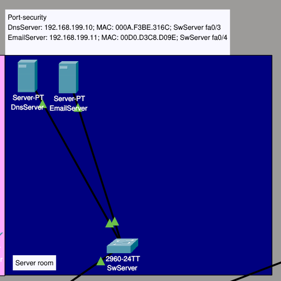

# Модуль 2: Core Switch Inter-VLAN Routing & DHCP

## 📌 Цель модуля

Настроить **коммутатор Ядра (Core 3560)** в качестве полноценного L3-устройства:

1. Включить маршрутизацию между отделами (**Inter-VLAN Routing**).
2. Поднять встроенный **DHCP-сервер** на `Core` для автоматической раздачи IP-адресов.
3. Настроить исключения диапазонов IP-адресов для служебного оборудования.

---

## 📚 Теория

### 🔄 Inter-VLAN Routing (Маршрутизация между VLAN)

В Модуле 1 мы настроили **"тупую" изоляцию** на L2-уровне — отделы просто не видят друг друга, и всё. Это хорошо для безопасности, но плохо для работы: разработчикам иногда нужно отправить письмо на почтовый сервер, а бухгалтерам — зайти на общий DNS.

**Что было в Модуле 1:**
* VLAN 10 (Development) изолирован от VLAN 20 (Engineering).
* ПК из VLAN 10 **не может** пропинговать ПК из VLAN 20.
* Серверы (DNS, Mail) тоже недоступны, потому что они в других VLAN.

**Проблема:** Нам нужно, чтобы отделы **не видели друг друга**, но **видели серверы** и могли выходить в интернет. А ещё DHCP должен работать внутри каждого VLAN.

---

**Решение:** Использовать L3-коммутатор (`Core 3560`), который умеет маршрутизировать трафик между VLAN. Вся маршрутизация происходит на аппаратном уровне внутри коммутатора с помощью виртуальных интерфейсов **SVI (Switch Virtual Interface)**.

> **Аналогия:**
> Представь, что каждый VLAN — это отдельный этаж в здании. На каждом этаже есть своя дверь (SVI). Чтобы попасть с первого этажа (VLAN 10) на второй (VLAN 20), нужно выйти в общий коридор (Core) и подняться по лестнице (маршрутизация). Лестницу включает администратор.

**Как это работает:**

1. Компьютер из VLAN 10 отправляет пакет на свой шлюз (`192.168.10.1`).
2. Шлюз — это SVI `interface vlan 10` на Core.
3. Core смотрит в таблицу маршрутизации и видит, что сеть `192.168.20.0/24` доступна через SVI `interface vlan 20`.
4. Core перенаправляет пакет на SVI VLAN 20, откуда он попадает к получателю в VLAN 20.

**Что нужно для активации маршрутизации на L3-коммутаторе Cisco:** Одна глобальная команда включает маршрутизацию между всеми SVI. Без неё Core работает как обычный L2-коммутатор.

**⚠️ Важный момент:** После включения маршрутизации **изоляция ломается** — все VLAN начинают видеть друг друга. Без дополнительных настроек любой отдел может пинговать любой другой.

---

### 🔒 Контролируемая изоляция через ACL

Чтобы вернуть контролируемую изоляцию, мы используем **ACL (Access Control Lists)**, списки контроля доступа. Они работают как **пропуска**: мы разрешаем только то, что нужно, и запрещаем всё остальное.

**В этом проекте ACL:**
* Разрешает DHCP-запросы внутри VLAN.
* Разрешает доступ к DNS-серверу (`192.168.199.10`).
* Разрешает доступ к Mail-серверу (`192.168.199.11`).
* Запрещает любой трафик между VLAN (отделы не видят друг друга).
* Разрешает всё остальное (доступ в интернет).

**Разбор ACL по строкам:**

| Строка | Что делает |
| :--- | :--- |
| `permit udp any any eq bootpc` | Разрешает DHCP-запросы от клиентов |
| `permit udp any any eq bootps` | Разрешает DHCP-ответы от сервера |
| `permit ip any host DNS-сервер` | Разрешает доступ к DNS |
| `permit ip any host Mail-сервер` | Разрешает доступ к почте |
| `deny ip 192.168.0.0/16 to 192.168.0.0/16` | **Запрещает** любой трафик между VLAN |
| `permit ip any any` | Разрешает всё остальное (интернет) |

> **Итог:** Мы возвращаем изоляцию между отделами, но с **контролируемыми исключениями**, серверы доступны всем, а отделы друг друга не видят.

---

> [!NOTE]
> **Запомни:** `ip routing` убирает изоляцию между VLAN. ACL позволяет вернуть её **с контролем**, мы сами решаем, кому и куда можно ходить.
---

### 📡 Встроенный DHCP-сервер на Ядре

Чтобы не прописывать IP-адреса на сотнях рабочих станций вручную, коммутатор Ядра будет автоматически выдавать сетевые настройки каждому отделу.

**Как работает DHCP:**

1. Компьютер включает питание и отправляет **broadcast-запрос** (DHCP Discover): "Эй, кто-нибудь дайте мне IP-адрес!".
2. Это broadcast-сообщение **не выходит за пределы своего VLAN** (спасибо изоляции).
3. На Core настроен SVI для этого VLAN. SVI принимает broadcast-запрос.
4. Core смотрит, с какого VLAN пришёл запрос, и отвечает из соответствующего пула:
   * Запрос из VLAN 10 → пул `DEVELOPMENT` → IP из `192.168.10.0/24`.
   * Запрос из VLAN 20 → пул `ENGINEERING` → IP из `192.168.20.0/24`.

**Структура DHCP-пула:**

```cisco
ip dhcp pool <NAME>
 network <СЕТЬ> <МАСКА>
 default-router <ШЛЮЗ>
 dns-server <DNS>
 domain-name <ДОМЕН>
```

**Исключения (`ip dhcp excluded-address`):**

Резервируем IP адреса, которые DHCP **не должен** выдавать обычным ПК:

* Шлюзы (например, `192.168.10.1`).
* Статические устройства: серверы, принтеры, сетевое оборудование.

Обычно резервируют первые 10-20 адресов в подсети:

```cisco
ip dhcp excluded-address 192.168.10.1 192.168.10.20
```

---

### 🔀 Схема работы Inter-VLAN Routing + DHCP

```text
                    [ Core 3560 ]
                         │
                 ip routing включён
                         │
    ┌────────────────────┼────────────────────┐
    │                    │                    │
┌───▼───┐          ┌─────▼─────┐        ┌─────▼─────┐
│SVI 10 │          │  SVI 20   │        │  SVI 30   │
│.10.1  │          │  .20.1    │        │  .30.1    │
└───┬───┘          └─────┬─────┘        └─────┬─────┘
    │                    │                    │
┌───▼───┐          ┌─────▼─────┐        ┌─────▼─────┐
│VLAN 10│          │  VLAN 20  │        │  VLAN 30  │
│.10.0/24│          │ .20.0/24  │        │ .30.0/24  │
└───────┘          └───────────┘        └───────────┘
```

**Что происходит:**

1. ПК из VLAN 10 запрашивает IP → Core выдаёт из пула `DEVELOPMENT`.
2. ПК получает IP `192.168.10.50`, шлюз `192.168.10.1`, DNS `8.8.8.8`.
3. ПК из VLAN 10 хочет пропинговать ПК из VLAN 20:
   * Пакет идёт на шлюз `192.168.10.1` (SVI 10).
   * Core получает пакет и проверяет его по ACL на SVI 10.
   * ACL запрещает трафик между VLAN → **пакет отбрасывается**.
   * Пинг не проходит, изоляция работает.
4. ПК из VLAN 10 обращается к DNS-серверу (`192.168.199.10`):
   * Пакет идёт на шлюз `192.168.10.1` (SVI 10).
   * Core проверяет пакет по ACL на SVI 10.
   * ACL разрешает доступ к DNS-серверу → пакет проходит.
   * Core отправляет пакет в VLAN 199 (серверная), где находится DNS.
   * Ответ от DNS возвращается обратно.

**Итог:** Отделы изолированы друг от друга, но имеют доступ к серверам. ACL на SVI контролирует весь входящий трафик: что можно, а что нельзя.

---


## 🛠 Практическая часть

### Изоляция VLAN

1. Перед началом настройки убедитесь, что все Trunk магистрали от коммутаторов отделов сходят в коммутатор `Core 3560`, а так же создайте сервеную команту во VLAN 199:

<p align="center">
  
</p>

(Port-security настроим в другом уроке)

---

2. Настройка изоляции на Core

Так как Core сейчас содержит в себе все VLAN, то движение трафика проходит через него, значит на нем и будем изолировать VLAN. Изоляция происходит с помощью ACL, и выглядит следующим образом:

```cisco
! 1. Создаем расширенный именованный список доступа (Extended ACL)
Core(config)# ip access-list extended <ACL_NAME>

! 2. Разрешаем транзит системных DHCP-запросов и ответов
Core(config-ext-nacl)# permit udp any any eq bootpc
Core(config-ext-nacl)# permit udp any any eq bootps

! 3. Разрешаем доступ со всех VLAN к общедоступным корпоративным сервисам
Core(config-ext-nacl)# permit ip any host <DNS_SERVER_IP>
Core(config-ext-nacl)# permit ip any host <MAIL_SERVER_IP>

! 4. Запрещаем любой перекрестный трафик между локальными подсетями (изоляция VLAN)
Core(config-ext-nacl)# deny ip <SUMMARY_NETWORK> <WILDCARD_MASK> <SUMMARY_NETWORK> <WILDCARD_MASK>

! 5. Разрешаем весь остальной исходящий трафик (выход в Интернет)
Core(config-ext-nacl)# permit ip any any
Core(config-ext-nacl)# exit

! 6. Применяем ACL на входящий трафик нужного SVI-интерфейса
Core(config)# interface vlan <VLAN_ID>
Core(config-if)# ip access-group <ACL_NAME> in
Core(config-if)# exit
```

### Разбор параметров шаблона:

* `<ACL_NAME>` — Понятное имя списка доступа (например, `VLAN_ISOLATION_ACL`).
* `<DNS_SERVER_IP>` — IP-адрес DNS-сервера в VLAN 199 (например, `192.168.199.10`).
* `<MAIL_SERVER_IP>` — IP-адрес Почтового сервера в VLAN 199 (например, `192.168.199.11`).
* `<SUMMARY_NETWORK>` — Агрегированная сеть или базовая подсеть компании (например, `192.168.0.0`).
* `<WILDCARD_MASK>` — Обратная маска (Wildcard) для блокировки диапазона всех VLAN (например, `0.0.255.255` для охвата всех подсетей `192.168.x.x`).
* `<VLAN_ID>` — Номер VLAN, к которому применяется фильтр (например, `10`, `20`, `30`).

В этом проекте VLAN изоляция выглядит так:

```cisco
Core#show access-lists
Extended IP access list VLAN-ISOLATION
    10 permit udp any any eq bootpc
    20 permit udp any any eq bootps
    30 permit ip any host 192.168.199.10
    40 permit ip any host 192.168.199.11
    50 deny ip 192.168.0.0 0.0.255.255 192.168.0.0 0.0.255.255
    60 permit ip any any
```

#### Основные команды для работы с ACL

**Просмотр ACL:**

```cisco
show access-lists                          ! все ACL со счётчиками
show ip access-lists <ACL_NAME>            ! конкретный ACL по имени
show ip interface vlan <VLAN_ID>           ! какие ACL привязаны к SVI
```

**Привязка и отвязка ACL:**

```cisco
ip access-group <ACL_NAME> in              ! применить ACL на SVI
no ip access-group <ACL_NAME> in           ! отвязать ACL от SVI
```

**Удаление и сброс ACL:**

```cisco
no ip access-list extended <ACL_NAME>      ! удалить ACL
clear access-list counters <ACL_NAME>      ! обнулить счётчики
```

### Настройка DHCP сервера

> [!NOTE]
> Никогда не настраивайте DHCP сервер на оборудовании, которое стоит в **серверной!** Оно должно быть строго статичным.
>
> Так же, статичными должны оставаться устройства для видео наблюдения, систем безопасности, сетевых принтеров и любого другого оборудования, к которому нужен постоянный предсказуемый доступ.

Перейдем на Core и создадим новый dhcp pool для VLAN 10, согласно шаблону из блока теории. В конце, Pool будет выглядет так:

```cisco
Pool DEVELOPMENT-POOL :
 Utilization mark (high/low)    : 100 / 0
 Subnet size (first/next)       : 0 / 0 
 Total addresses                : 254
 Leased addresses               : 12
 Excluded addresses             : 13
 Pending event                  : none

 1 subnet is currently in the pool
 Current index        IP address range                    Leased/Excluded/Total
 192.168.10.1         192.168.10.1     - 192.168.10.254    12   / 13    / 254
```

Теперь перейдем на любой компьютер в VLAN 10, в раздел Desktop → IP Configuration и переключим режим со Static IP на DHCP. Через пару секунд должен автоматически прийти новый свободный IP-адрес.

Если этого не произошло, откройте терминал (Command Prompt) на том же ПК и выполните команды:

```cmd
ipconfig /release
ipconfig /renew
```

**Пояснение команд:**

| Команда | Что делает |
| :--- | :--- |
| `ipconfig /release` | Принудительно освобождает текущий IP-адрес, который компьютер получил от DHCP-сервера |
| `ipconfig /renew` | Отправляет новый DHCP-запрос (DHCP Discover) и получает свежий IP-адрес из свободного пула |

Эти команды полезны, если DHCP-сервер был настроен позже, чем включился компьютер, или если нужно принудительно сменить IP без перезагрузки.

### Основные команды для работы с DHCP-сервером

**Просмотр статуса DHCP:**

```cisco
show ip dhcp binding              ! список выданных IP-адресов (MAC → IP)
show ip dhcp pool                 ! статистика по пулам (всего / выдано / свободно)
show ip dhcp server statistics    ! общая статистика DHCP сервера (запросы, ответы)
```

**Исключения и настройки:**

```cisco
ip dhcp excluded-address <IP_НАЧАЛО> <IP_КОНЕЦ>   ! зарезервировать диапазон (не выдавать)
service dhcp                                     ! включить DHCP сервис (включен по умолчанию)
```

**Отладка и сброс:**

```cisco
debug ip dhcp server events        ! включить отладку DHCP событий
debug ip dhcp server packets       ! включить отладку DHCP пакетов
clear ip dhcp binding *            ! очистить все выданные привязки (принудительно)
clear ip dhcp binding <IP>         ! очистить привязку для конкретного IP
```

> [!NOTE]
> После `clear ip dhcp binding` компьютеры продолжат использовать старые IP адреса до истечения времени аренды или до принудительного обновления (`ipconfig /renew` на ПК).


